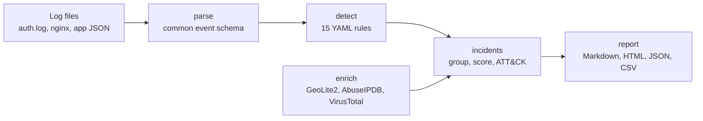

# Prohori (প্রহরী)

<!-- Build and security -->
[](https://github.com/UtshaBasak/Prohori/actions/workflows/ci.yml)
[](https://github.com/UtshaBasak/Prohori/actions/workflows/codeql.yml)
[](https://scorecard.dev/viewer/?uri=github.com/UtshaBasak/Prohori)
[](https://github.com/gitleaks/gitleaks)
[](https://github.com/UtshaBasak/Prohori/blob/main/.github/dependabot.yml)

<!-- Package -->


[](LICENSE)

<!-- Tooling and conventions -->
[](https://github.com/astral-sh/uv)
[](https://github.com/astral-sh/ruff)
[](https://mypy-lang.org/)
[](https://github.com/pre-commit/pre-commit)
[](https://www.conventionalcommits.org/)
[](CODE_OF_CONDUCT.md)

<!-- Repository -->
[](https://github.com/UtshaBasak/Prohori/commits/main)
[](https://github.com/UtshaBasak/Prohori/graphs/commit-activity)
[](https://github.com/UtshaBasak/Prohori/issues)
[](https://github.com/UtshaBasak/Prohori/pulls)
[](https://github.com/UtshaBasak/Prohori/wiki)
[](CONTRIBUTING.md)

**A laptop-sized mini-SOC: from raw logs to detections, enriched incidents and analyst-ready
reports, with honest machine-learning evaluation and a streaming data pipeline.**

*Prohori* (প্রহরী) is Bengali for "guard". It is an open-source, defensive security-operations
toolkit in Python that runs on a single laptop with free tools only, offline by default.

> **Status: pre-alpha.** The batch core works today, from log file to shareable report:
> `parse`, `detect`, `enrich`, `incidents` and `report`. The simulator, the `triage` and `demo`
> commands and the first PyPI release (v0.1.0) are next. See the [CHANGELOG](CHANGELOG.md) and
> the [roadmap](#roadmap).

## Contents

- [What it does](#what-it-does)
- [Quick start](#quick-start)
- [Example: an account takeover](#example-an-account-takeover)
- [Commands](#commands)
- [Built-in detection rules](#built-in-detection-rules)
- [Privacy and safety](#privacy-and-safety)
- [Documentation](#documentation)
- [Roadmap](#roadmap)
- [Development](#development)

## What it does



| Stage | Today |
|-------|-------|
| **Parse** | Linux `auth.log` (sshd, sudo, PAM), nginx/Apache access logs, application security events (JSON Lines) and any JSON Lines layout through a YAML field mapping, into one typed event schema. Format detection, streaming with bounded memory, hostile input handled (oversized lines, bad encodings, control characters). |
| **Detect** | 15 readable YAML rules (Sigma-inspired) with field modifiers, thresholds, distinct counts, ratios, sliding and tumbling windows and ordered sequences. Every rule ships with test fixtures and a runbook; regular expressions run on RE2, so no pattern can hang a run. |
| **Enrich** | IP geolocation, network owner and reputation from local GeoLite2 files, AbuseIPDB and VirusTotal, all optional. SQLite cache, daily budgets, rate limiting and bounded retries. Private and documentation addresses never leave the machine. |
| **Incidents** | Related alerts (same IP, account, request or session within a time gap) become one incident with a points-based score you can read line by line, severity, confidence, MITRE ATT&CK v20.0 mapping, a timeline, recommended actions and stated limitations. Detects sign-ins from an IP or app new to the account. |
| **Report** | Markdown, a self-contained HTML page, JSON or a CSV timeline, with an appendix of input and rule-file SHA-256 hashes. `--redact` replaces account names, ids and emails (and optionally IPs) with keyed pseudonyms, and refuses to write a report that would still leak one. |

Prohori only **recommends** actions. It never blocks addresses, disables accounts or touches
remote systems.

## Quick start

Requires Python 3.11+ and [uv](https://docs.astral.sh/uv/). Everything below runs offline on the
bundled synthetic samples.

```bash
git clone https://github.com/UtshaBasak/Prohori.git && cd Prohori
uv sync

uv run prohori parse samples/logs/auth.log                      # normalise a log
uv run prohori detect samples/logs/auth.log                     # run the 15 rules
uv run prohori enrich 203.0.113.7 --offline                     # look up an IP (demo data)
uv run prohori incidents samples/logs/account-takeover.jsonl    # group alerts into incidents
uv run prohori report samples/incidents/INC-ee7c8818fbb34989.json -f html -o report.html
```

Open `report.html` in a browser: one file, no scripts, no external resources.

## Example: an account takeover

`samples/logs/account-takeover.jsonl` is a synthetic attack on a web shop account: twelve wrong
passwords from one IP in 33 seconds, a successful sign-in, two-step verification switched off and
the bKash payout number changed. Prohori raises four alerts and joins them into **one critical
incident**:

```text
$ uv run prohori incidents samples/logs/account-takeover.jsonl     # first lines
INC-ee7c8818fbb34989  critical  score 100
+-------------------------------------------------------------------------------------------------+
| title       | Successful sign-in after many failures from one IP and 3 related alerts           |
| time (UTC)  | 2026-10-24 21:10:00 - 2026-10-24 21:13:10                                         |
| confidence  | high                                                                              |
| rules       | PRH-ACCT-001, PRH-AUTH-001, PRH-AUTH-003                                          |
| entities    | source.ip: 203.0.113.7                                                            |
|             | user.email_hash: 0cc175b9c0f1b6a831c399e269772661                                 |
|             | user.id: u-2001                                                                   |
```

Every point of the score is explained (from `prohori report`):

| Points | Reason |
|-------:|--------|
| +50 | Most severe alert: PRH-AUTH-003 (critical) |
| +20 | 2 more rules fired: PRH-ACCT-001, PRH-AUTH-001 |
| +20 | A sign-in succeeded after failed attempts |
| +15 | Sensitive account or admin change: account.2fa.disabled, account.bkash.changed |
| +20 | Reputation of 203.0.113.7: abuse confidence 97; 9 vendors flag it as malicious (from bundled demo data) |
| +10 | Sign-in to u-2001 from 203.0.113.7, an IP not seen for this account before (1 earlier IP) |
| +5 | Sign-in to u-2001 with client web, not seen for this account before |
| -40 | Capped at 100 |
| **100** | **Total** |

The report adds the timeline, the IP's enrichment, the ATT&CK techniques (T1110 Brute Force,
T1078 Valid Accounts, T1098 Account Manipulation, T1556.006 Multi-Factor Authentication),
recommended actions from the runbooks and the limitations, such as "single log source" and
"enrichment is bundled demo data".

## Commands

| Command | What it does | Docs |
|---------|--------------|------|
| `prohori parse FILE` | Parse and normalise a log; table or JSON Lines | [PARSERS.md](docs/PARSERS.md) |
| `prohori detect FILE` | Run the 15 built-in rules (and `--rules DIR`); exit code 3 when alerts are found | [RULES.md](docs/RULES.md) |
| `prohori rules list` / `validate` / `test` | Show, check and test detection rules | [RULES.md](docs/RULES.md) |
| `prohori enrich IP...` | Geolocation and reputation; `--offline` never uses the network | [ENRICHMENT.md](docs/ENRICHMENT.md) |
| `prohori incidents FILE` | Parse, detect and group alerts into scored incidents; offline enrichment unless `--online` | [INCIDENTS.md](docs/INCIDENTS.md) |
| `prohori report INCIDENT` | Render an incident as `md`, `html`, `json` or `csv`; `--redact`, `--redact-ips` | [REPORTS.md](docs/REPORTS.md) |
| `prohori version` | Show the version | |

Commands that take a file also read standard input with `-`, and every command has `--help`.
`detect` and `incidents` exit with `0` when nothing is found, `3` when alerts or incidents are
found (`--exit-zero` turns this off for CI pipelines), `1` when nothing could be parsed and `2`
for invalid usage.

## Built-in detection rules

| Rule | Detects | Severity | ATT&CK |
|------|---------|----------|--------|
| PRH-AUTH-001 | Brute-force sign-in attempts from one IP | high | T1110, T1110.001 |
| PRH-AUTH-002 | Password spraying or credential stuffing from one IP | high | T1110.003, T1110.004 |
| PRH-AUTH-003 | Successful sign-in after many failures from one IP | critical | T1110, T1078 |
| PRH-AUTH-004 | Account lockouts across many accounts | high | T1110 |
| PRH-SESS-001 | Refresh-token reuse | high | T1528, T1550.001 |
| PRH-ACCT-001 | Sensitive account change shortly after sign-in | high | T1098, T1556.006 |
| PRH-AUTHZ-001 | Authorisation denials across many resources | medium | T1595.003 |
| PRH-ABUSE-001 | Rate-limit bursts or bot-check failures from one IP | medium | T1499.002 |
| PRH-ADMIN-001 | Admin role granted | high | T1098 |
| PRH-ADMIN-002 | Admin action at an unusual hour (22:00-07:00 local time) | medium | T1078 |
| PRH-WEB-001 | Web scanning from one IP | medium | T1595.003 |
| PRH-WEB-002 | Injection patterns in request paths | medium | T1190 |
| PRH-WEB-003 | Scanner or empty user agent at a high request rate | medium | T1595.002 |
| PRH-WEB-004 | Probes for sensitive files and admin tools | medium | T1595.003 |
| PRH-SSH-001 | SSH invalid-user storm or repeated authentication-limit disconnects | high | T1110, T1110.001 |

ATT&CK tags are verified against the official Enterprise ATT&CK v20.0 data. Each rule has a
runbook in [`src/prohori/runbooks/`](src/prohori/runbooks/). Writing your own rules is covered in
[docs/RULES.md](docs/RULES.md).

## Privacy and safety

- **Offline by default.** Nothing leaves the machine unless you configure API keys and, for
  incidents, pass `--online`. Tests block real network access.
- **Private, reserved and documentation IP addresses are never sent** to outside services, even
  when keys are configured. VirusTotal keeps the addresses it is asked about, so querying is a
  deliberate choice.
- **Logs are untrusted input.** Parsers cap line lengths and strip control characters; reports
  escape every value for their format (HTML, Markdown, CSV formulas) and are tested with hostile
  input.
- **Shareable reports.** `--redact` / `--redact-ips` use keyed pseudonyms and fail closed.
- **No secrets in the repository.** API keys live in the environment or a git-ignored `.env`;
  gitleaks runs on every commit and in CI.
- **Samples are synthetic** and use documentation address ranges only.

Third-party data terms (MITRE ATT&CK, GeoLite2, AbuseIPDB, VirusTotal) are summarised in
[docs/LICENSES.md](docs/LICENSES.md).

## Documentation

| Document | Contents |
|----------|----------|
| [Architecture](docs/ARCHITECTURE.md) | Components, data flow and run modes |
| [Event schema](docs/SCHEMA.md) | Event, Alert and Incident fields |
| [Parsers](docs/PARSERS.md) | Supported formats, options and field mappings |
| [Rules](docs/RULES.md) | Rule format, evaluation semantics, testing and the built-in rules |
| [Enrichment](docs/ENRICHMENT.md) | Providers, privacy, cache, limits and configuration |
| [Incidents](docs/INCIDENTS.md) | Grouping, the scoring table, confidence and limitations |
| [Reports](docs/REPORTS.md) | Formats, sections, redaction and output safety |
| [Decisions](docs/DECISIONS.md) | Architecture decision records |
| [Third-party terms](docs/LICENSES.md) | Data and service licences |
| [Wiki](https://github.com/UtshaBasak/Prohori/wiki) | Installation, quick start and guides |

## Roadmap

| Release | Contents | State |
|---------|----------|-------|
| v0.1.0 | Batch core: parsers, rules, enrichment, incidents, reports, log simulator with rule evaluation, `triage` and `demo` commands | Most of it is built; simulator and `triage` next |
| v0.2.0 | Machine learning: leakage-controlled intrusion detection on public flow datasets, log-derived anomaly detection, model cards | Planned |
| v0.3.0 | Pipeline: streaming core, Redpanda and PostgreSQL in Docker, dbt models, dashboard, orchestration | Planned |
| v1.0.0 | Optional LLM analyst (opt-in, redacted input, validated output), final polish | Planned |

## Development

```bash
uv sync                        # create .venv with the package and dev tools
uv run pre-commit install      # optional: run checks on every commit

uv run ruff check .            # lint
uv run ruff format --check .   # formatting
uv run mypy                    # strict type check
uv run pytest --cov            # tests with coverage (kept at 85 % or more)
uv run prohori rules test      # run every rule against its fixtures
```

CI runs on Linux and Windows with Python 3.11 to 3.14, plus CodeQL, secret scanning, parser
fuzzing and the OpenSSF Scorecard. All GitHub Actions are pinned to commit SHAs. See
[CONTRIBUTING.md](CONTRIBUTING.md) for conventions.

## Security

To report a vulnerability, see [SECURITY.md](SECURITY.md).

## License

[MIT](LICENSE). Third-party data has its own terms; see [docs/LICENSES.md](docs/LICENSES.md).
