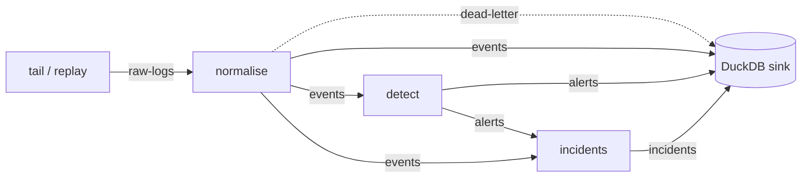

# Streaming Pipeline

The batch commands read a whole file and stop. The pipeline runs the same parsers, rules and
incident builder continuously. It takes log lines as they are written, sends them through a chain
of consumers, and stores events, alerts, incidents and rejected messages in a database. It runs
in two ways:

- **Lite mode** runs every stage in one process over files and writes to DuckDB, without Docker.
- **The Docker stack** runs each stage in its own container over Redpanda, a Kafka-compatible
  broker, and writes to a PostgreSQL warehouse.

Design decisions are in [ADR-0023](DECISIONS.md#adr-0023-streaming-core-and-lite-mode) (lite
mode) and [ADR-0024](DECISIONS.md#adr-0024-docker-stack-kafka-and-postgresql) (the stack).

## Contents

- [Quick start](#quick-start)
- [How it works](#how-it-works)
- [Topics and messages](#topics-and-messages)
- [Delivery guarantees](#delivery-guarantees)
- [Dead letters](#dead-letters)
- [Following live logs](#following-live-logs)
- [The database](#the-database)
- [Counters](#counters)
- [Performance](#performance)
- [The Docker stack](#the-docker-stack)
- [Limitations](#limitations)

## Quick start

Both modes need the `pipeline` extra: DuckDB, the Kafka client (confluent-kafka) and the
PostgreSQL client (psycopg). Lite mode:

```bash
pip install "prohori[pipeline]"          # or, from a clone: uv sync --extra pipeline

prohori simulate web-scanning --seed 1 --out logs/
prohori pipeline replay logs/web-scanning.log          # replay the file, then stop
prohori pipeline replay logs/web-scanning.log          # again: no new rows
prohori pipeline tail /var/log/auth.log --year 2026    # follow a live log until Ctrl+C
```

Both commands keep their state in `.prohori/pipeline/` (change it with `--state`) and write to
`.prohori/pipeline/prohori.duckdb` (change it with `--db`). They print a table of counters when
they stop (`-f json` for JSON). They take the same rule, parser and enrichment options as
`prohori incidents`. Enrichment is offline by default, `--online` uses the configured providers
and `--no-enrich` turns it off. `replay --times N` publishes each file N times, which shows that
duplicates are stored once.

To start over, delete the state directory.

## How it works



| Stage | Reads | Writes | What it does |
|-------|-------|--------|--------------|
| Producer | log files | `raw-logs` | `replay` reads a whole file; `tail` follows a growing file through rotation. Each line keeps its line number. |
| `normalise` | `raw-logs` | `events` | Parses each line with one parser per source, so parser state such as the year of `auth.log` timestamps carries across lines. |
| `detect` | `events` | `alerts` | Drops events it has seen before, then runs the rule engine (same rules, same reorder buffer as `prohori detect`). |
| `incidents` | `alerts`, `events` | `incidents` | Remembers the events, holds alerts until their group can no longer grow, then builds incidents with the same builder as `prohori incidents`. |
| `sink` | `events`, `alerts`, `incidents`, `dead-letter` | DuckDB | Writes each batch in one transaction, ignoring ids it already has. |

In lite mode the stages take turns in one process. Each round, the producers publish new lines
and each stage processes one batch of up to 500 messages per input. A replay runs rounds until
nothing moves. Then each stage releases what it still holds (the rule engine's reorder buffer,
open incidents), in pipeline order, so the last incidents reach the database.

**When an incident is final.** A later alert joins a group if it starts within the incident gap
(30 minutes by default) of the group's last alert. A threshold or sequence alert can start up to
its rule's window before it is raised, and events may arrive up to the lateness (5 minutes) out
of order. The incident stage therefore closes a group only when the newest alert time is past the
group's end by gap + longest rule window + lateness (65 minutes with the built-in rules). When
following live logs, a group also closes after that much wall-clock time without new alerts.

**Same results as the batch command.** The integration tests replay every simulator scenario
twice through lite mode. They check that the incidents in DuckDB are exactly those of
`prohori incidents` on the same file (same ids, same content apart from provenance), with no
duplicate rows.

## Topics and messages

| Topic | Key | Payload |
|-------|-----|---------|
| `raw-logs` | source file name | `RawLog`: `v`, `source`, `line`, `text`, `parser`, `read_at`, `too_long`, `decode_error` |
| `events` | event id | [`Event`](SCHEMA.md) |
| `alerts` | alert id | [`Alert`](SCHEMA.md) |
| `incidents` | incident id | [`Incident`](SCHEMA.md) |
| `dead-letter` | dead-letter id | `DeadLetter`: `v`, `id`, `stage`, `topic`, `key`, `reason`, `payload` (at most 4,096 characters) |

Messages are JSON objects with a key. A raw line is keyed by its file so one file's lines stay in
order. The rule engine needs events in time order, so the `events` topic is one partition.
`raw-logs` and `dead-letter` payloads carry a schema version `v` (now 1).

`read_at` is when the producer read the file: the file's modification time for a replay, the
current time when tailing. The `auth_log` parser uses it to infer the year of syslog timestamps,
exactly as the batch commands use the file's modification time.

In lite mode each topic is a JSON Lines file in `.prohori/pipeline/topics/`, and each consumer's
committed position is a byte offset in `.prohori/pipeline/offsets/`.

## Delivery guarantees

- **At least once.** A stage reads a batch, publishes what it produced, flushes (and fsyncs) the
  topic files and only then commits its position. If the process dies in between, the batch is
  read again after a restart.
- **Each id stored once.** Ids are hashes of content: an event id covers the source, timestamp,
  line and line number; an alert id covers the rule and its events; an incident id covers its
  alerts. The same input therefore always yields the same ids, and the sink writes with
  `INSERT OR IGNORE`. A replayed file, a redelivered batch or a restart adds no rows. The
  integration tests check this after a simulated crash mid-run.
- **Duplicates never count twice.** The detector drops events whose id it has seen (it
  remembers the last 100,000), so a replayed line cannot push a threshold rule over its limit. An
  event older than what the engine has already evaluated is dropped as late, as in batch mode.
  The incident stage ignores alerts it has already put into an incident.
- **State is rebuilt, not checkpointed.** The detector's windows and the incident stage's open
  groups live in memory. When the pipeline starts, these two stages read their inputs from the
  start of the topics and rebuild the same state, producing the same alerts and incidents. That
  is simple and correct, but the topics grow without limit in lite mode, so a long-running
  installation should be restarted with a fresh state directory now and then.
- **A torn write is contained.** If the process dies halfway through writing a message, readers
  stop before the unfinished line. The next writer ends it with a newline, so it becomes one
  malformed message (a dead letter) instead of corrupting the next one.

## Dead letters

A message a stage cannot use goes to the `dead-letter` topic and the `dead_letters` table, with
the stage, topic, key, reason and the beginning of the payload. Such messages are:

- a line no parser accepts (`normalise`, reason as in `prohori parse`, such as
  `line does not match the access log pattern`);
- a message that is not JSON or not a keyed message (`not valid JSON`, `not a keyed message`);
- a message whose payload does not match its schema (`invalid timestamp: ...`);
- a message whose processing raised an error (`processing failed: KeyError`; the error is
  logged).

Dead letters are counted per stage and never retried, so one bad message cannot stall the
pipeline. Blank and irrelevant lines (a cron line in `auth.log`) are counted by the parser but
are not dead letters.

## Following live logs

`prohori pipeline tail FILE...` checks each file every second (`--poll`):

- A line is published once it ends with a newline. A line still being written is left for the
  next check.
- **Rotation by rename** (`auth.log` becomes `auth.log.1` and a new `auth.log` appears): the
  tailer notices that the path now points to another file. It reads the old file to its end,
  then the new one from its start.
- **Rotation by truncation** (`copytruncate`): the file becomes shorter than the position read,
  so reading restarts at its start.
- **Restarts.** The position, line number and file identity are saved under
  `.prohori/pipeline/tail/` after each check. A restart continues where it stopped if the file is
  still the same one; otherwise it reads the file from its start.
- **Windows.** A file opened the usual way on Windows cannot be renamed or deleted, which would
  break the writing program's log rotation. The tailer opens files with every sharing flag
  (`FILE_SHARE_READ | FILE_SHARE_WRITE | FILE_SHARE_DELETE`). The rotation tests run on Windows
  and Linux in CI.
- After 10 seconds without new lines the rule engine releases the events it holds for
  reordering, so the last alerts of a quiet log are not held back.
- **Ctrl+C** (or SIGTERM, or Ctrl+Break on Windows) stops between rounds. The tailer finishes the
  current batch, writes the incidents still open and commits.

## The database

DuckDB file, four tables, each keyed by the message id. `record` holds the whole message as
JSON, and `stored_at` is when the row was first written. Two more tables, `labels` and
`model_evaluations`, are filled by `prohori pipeline load-labels` and `load-results`. The dbt
models in [WAREHOUSE.md](WAREHOUSE.md) build on all six.

| Table | Columns |
|-------|---------|
| `events` | `id`, `timestamp`, `log_source`, `action`, `category`, `outcome`, `source_ip`, `user_name`, `http_status`, `record` |
| `alerts` | `id`, `detector_id`, `detector_kind`, `severity`, `first_seen`, `last_seen`, `title`, `event_count`, `record` |
| `incidents` | `id`, `severity`, `score`, `confidence`, `first_seen`, `last_seen`, `title`, `alert_count`, `record` |
| `dead_letters` | `id`, `stage`, `topic`, `key`, `reason`, `payload` |

```sql
-- with the DuckDB command-line tool (a separate download from duckdb.org):
-- duckdb .prohori/pipeline/prohori.duckdb
SELECT detector_id, count(*) FROM alerts GROUP BY 1 ORDER BY 2 DESC;
SELECT id, severity, score, title FROM incidents ORDER BY score DESC;
SELECT source_ip, count(*) FROM events WHERE outcome = 'failure' GROUP BY 1 ORDER BY 2 DESC;
SELECT record->>'$.recommended_actions' FROM incidents;
```

Timestamps are `TIMESTAMPTZ`. Reading them into Python datetime objects through the `duckdb`
module needs `pytz`, so either cast them (`first_seen::VARCHAR`) or install `pytz`. Only one
process may open the file for writing; stop the pipeline (or open the file read-only) to query
it.

## Counters

The table printed at the end has, for each stage, messages consumed and produced, dead letters
and duplicates dropped. The sink's "produced" column counts rows sent to the database;
duplicates are then ignored there. `-f json` adds the parser counters (lines, events, skipped,
blank, errors), the rule engine counters (late events, expired groups) and the row count of each
table.

## Performance

Lite mode is several times slower than `prohori incidents` on the same file: each event is
validated and serialised once per stage, and each batch is made durable (fsync) before it is
committed. The measured throughput and memory on a log of a million lines are in
[PERFORMANCE.md](PERFORMANCE.md). Lite mode is for a single host's logs; the Docker stack is the
scalable one.

## The Docker stack

The same four stages also run as separate containers over a real message broker, with a
PostgreSQL warehouse. This is the shape of a production deployment, on one machine.

```bash
git clone https://github.com/UtshaBasak/Prohori.git && cd Prohori && uv sync
uv run prohori pipeline up                    # build the image, start everything, wait until healthy
uv run prohori simulate web-scanning --seed 1 --out logs   # write a simulated log to replay
uv run prohori pipeline replay logs/web-scanning.log --bootstrap 127.0.0.1:19092
uv run prohori pipeline status                # services, health and warehouse row counts
# dashboards at http://127.0.0.1:13000 (docs/DASHBOARD.md)
uv run prohori pipeline down                  # stop; add --volumes to delete the data too
```

It needs Docker (Docker Desktop with the WSL 2 engine on Windows) and a clone of the repository,
because the image is built from the checkout with the versions pinned in `uv.lock`. The first
`up` builds the image and pulls Redpanda, PostgreSQL and Grafana, which takes a few minutes. Later starts
take about a minute.

| Service | Image | Role | Memory limit |
|---------|-------|------|-------------:|
| `redpanda` | Redpanda v26.2.4, one node, one core | Kafka-compatible broker | 1.5 GB |
| `postgres` | PostgreSQL 17.11 (Alpine) | Warehouse, `raw` schema | 512 MB |
| `normalise` | `prohori:local` | `prohori pipeline run --stage normalise` | 256 MB |
| `detect` | `prohori:local` | `... --stage detect` | 384 MB |
| `incidents` | `prohori:local` | `... --stage incidents --idle-close 60` | 384 MB |
| `sink` | `prohori:local` | `... --stage sink`, into PostgreSQL | 256 MB |
| `warehouse-init` | PostgreSQL 17.11 (Alpine) | Runs once per `up`: schemas and Grafana's read-only role | 64 MB |
| `grafana` | Grafana 13.2.5 (Alpine) | Provisioned dashboards ([DASHBOARD.md](DASHBOARD.md)) | 512 MB |
| `airflow` (orchestration profile) | Airflow 3.3.2 with Prohori and dbt | Scheduled jobs ([ORCHESTRATION.md](ORCHESTRATION.md)) | 3 GB |

The limits add up to about 3.9 GB, or 6.9 GB with `--orchestration`. Measured with `docker stats` on the development laptop:

| Situation | Whole stack | Highest single container |
|-----------|------------:|--------------------------|
| Idle after a 622-line replay | about 440 MB | Redpanda, about 200 MB |
| During a 50,700-line replay | about 700 MB at peak | Redpanda 267 MB of 1.5 GB; sink 102 MB of 256 MB |
| Restarting detect and incidents with that backlog (they rebuild from the start) | | incidents about 100 MB of 384 MB |
| Idle after replaying all eight simulator scenarios (7,498 events), dashboards open | about 720 MB | Grafana about 250 MB of 512 MB |

- **The stage image** is also published, for each release, as `ghcr.io/utshabasak/prohori`
  (linux/amd64 and linux/arm64). The stack builds its own from the checkout.
- **Images** are pinned by digest. The Prohori image runs as an unprivileged user, and its build
  context holds only `pyproject.toml`, `uv.lock`, the README, licence, changelog and `src/`
  (see `.dockerignore`), never `data/`.
- **Ports** are published on 127.0.0.1 only: the broker on 19092, PostgreSQL on 15432,
  Grafana on 13000 and Airflow on 18080, chosen so they do not clash with local services. The PostgreSQL password defaults to a local-only
  value. To change it, set `PROHORI_POSTGRES_PASSWORD` (and `PROHORI_POSTGRES_PORT`) in the
  environment of both `prohori pipeline up` and `prohori pipeline status`. Compose also reads
  them from `pipeline/.env` (git-ignored), but `status` reads only the environment. The broker
  has no authentication or TLS, which is fine on one machine and not anywhere else.
- **Health.** Redpanda, PostgreSQL and Grafana have their own health checks (PostgreSQL's
  connects over TCP, so it does not pass during the first start's initialisation). Each stage container touches
  a heartbeat file after every round and is healthy while the file is less than a minute old, so
  a stuck stage shows up even when its process is still alive. `up` waits until every service is
  healthy; `status` shows the state and exits 1 if anything is not.
- **Shutdown.** The containers run with an init process, so `down` (or `docker compose stop`)
  sends SIGTERM to Prohori. The stage finishes its batch, releases what it holds, commits and
  prints its counters. The stack stops in a few seconds.
- **Containers restart** unless stopped. A stage that hits a database or broker error stops
  without committing, restarts, and processes the same batch again.

### Over Kafka

`prohori.pipeline.kafka.KafkaTransport` implements the same transport as lite mode:

- Every topic has one partition and unlimited retention. Topics are created with those settings
  by whichever client starts first, before anything is published.
- Each consumer group is assigned the partition directly, without rebalancing. A stage commits
  the offset after its output has been flushed. The producer is idempotent and waits for every
  replica, and a message that was not delivered makes the flush fail, so input is never
  committed when its output was lost.
- The incident stage reads the `events` topic up to its end offset before handling the alerts it
  polled, so the events behind an alert are always in its memory, even though another container
  produced them.
- The detector and the incident stage rebuild their state from the start of their topics when
  they start, exactly as in lite mode.

`replay --bootstrap` and `tail --bootstrap` only publish raw lines. The stage containers do the
rest. `prohori pipeline run --stage NAME` is what each container runs. It takes the broker from
`--bootstrap` or `PROHORI_KAFKA_BOOTSTRAP`, and the warehouse from `--postgres` or
`PROHORI_POSTGRES_DSN`.

**Incidents in a long-running stack.** The containers never reach the end of their input, so an
incident is written when its group can no longer grow (65 minutes past its end in alert time)
or, in the stack, after 60 seconds without new alerts. Without that, the last incident of a
replay would wait for the next attack. The cost is that an attack slower than one alert every
minute can be split into two incidents. Raise `--idle-close` in the compose file if that
matters more than speed.

**Same answers as batch.** The smoke test (`tests/integration/test_docker_stack.py`, run by the
`Docker stack` workflow on Linux) starts the real stack from empty volumes. It replays a
simulated attack twice and waits for the warehouse. It then checks that each event is stored
once, that there are no dead letters, and that the incident ids equal those of
`prohori incidents` on the same file. It runs every dashboard panel's query through Grafana's
API: the raw-table panels must return rows with no dbt run, and the mart panels must run after
`dbt build`. It also checks that a stage stops gracefully on SIGTERM
and that `down` removes every container. Locally, run it with
`PROHORI_DOCKER_TESTS=1 uv run pytest tests/integration/test_docker_stack.py`. It deletes the
stack's data volumes.

### The warehouse

The `raw` schema has the same four tables as the DuckDB file (`events`, `alerts`, `incidents`,
`dead_letters`), with `JSONB` for the full message in `record`. Rows are inserted with
`ON CONFLICT (id) DO NOTHING`. NUL characters, which PostgreSQL text cannot hold, are replaced
with U+FFFD before writing. If the database rejects a batch because of its data, the rows are
written one by one and the rejected ones become dead letters. Any other database error stops the
stage, and the batch is delivered again. The dbt models in [WAREHOUSE.md](WAREHOUSE.md) build
on this schema, and the dashboards in [DASHBOARD.md](DASHBOARD.md) read it.

```bash
docker exec -it prohori-postgres-1 psql -U prohori -d prohori
```
```sql
SELECT severity, score, title FROM raw.incidents ORDER BY score DESC;
SELECT record->>'detector_id' AS rule, count(*) FROM raw.alerts GROUP BY 1 ORDER BY 2 DESC;
```

## Limitations

- **One process, one writer (lite mode).** A state directory and its database belong to one
  running pipeline.
- **One broker, one partition (stack).** The stack is a single-node Redpanda with one partition
  per topic, because the rule engine needs every event in order. It runs on one machine, with no
  broker authentication; it is not a cluster.
- **Topics are not trimmed.** Topics grow with every line, in lite mode and in the stack. The
  stateful stages re-read them at start-up, so start-up time grows too. To start over, delete
  the state directory (lite mode) or run `prohori pipeline down --volumes` (the stack).
- **Anomaly detectors are not in the pipeline.** `--models` compares a whole log with itself,
  which does not fit a stream; it stays a batch feature.
- **One timeline.** The rule engine sees everything as one stream in time order, in lite mode
  (across runs that share a state directory) and in the stack. A log that is older than what has
  already been processed is stored, but its events arrive too late for the rules: they are
  counted as late events (in the counters, and as a warning in the detect container's log) and
  raise no alerts. Replay older logs first, or start from fresh topics (a new state directory,
  or `prohori pipeline down --volumes`), or use the batch commands for archived logs.
- **Year inference when tailing.** Without `--year`, syslog timestamps that carry no year get
  one from the time the tailer first reads the file. That is right for a live log, but not for
  an old file tailed from its start in the next year.
- **Rotation edge cases.** If a file is truncated and then grows past the old position between
  two checks, the truncation is not noticed. If an old file's inode number is reused by a new
  file that is at least as long, the tailer resumes in the middle of it. Common tailers share
  both limits.
- **Incidents open at shutdown are written as they are.** On the next start the incident stage
  rebuilds its state from the topics, so if the same attack continues, the rebuilt incident holds
  the earlier alerts and the new ones under a new id. It is stored next to the partial incident
  written at shutdown, and the two overlap.
