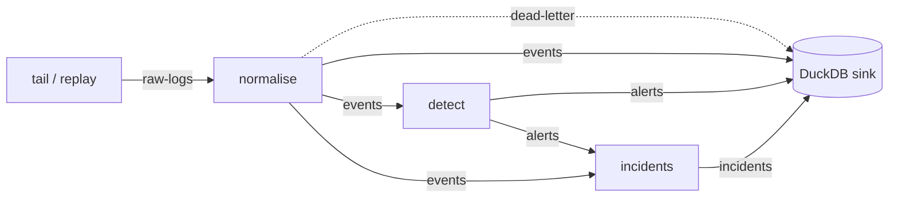

# Streaming Pipeline

The batch commands read a whole file and stop. The pipeline runs the same parsers, rules and
incident builder continuously. It takes log lines as they are written, sends them through a chain
of consumers, and stores events, alerts, incidents and rejected messages in a database. The same
consumers can run over a Kafka-compatible queue in Docker (step 19); **lite mode** runs them in
one process over files, without Docker. This page describes lite mode. Design decisions are in
[ADR-0023](DECISIONS.md#adr-0023-streaming-core-and-lite-mode).

## Contents

- [Quick start](#quick-start)
- [How it works](#how-it-works)
- [Topics and messages](#topics-and-messages)
- [Delivery guarantees](#delivery-guarantees)
- [Dead letters](#dead-letters)
- [Following live logs](#following-live-logs)
- [The database](#the-database)
- [Counters](#counters)
- [Performance](#performance)
- [Limitations](#limitations)

## Quick start

Lite mode needs the `pipeline` extra, which adds DuckDB:

```bash
pip install "prohori[pipeline]"          # or, from a clone: uv sync --extra pipeline

prohori simulate web-scanning --seed 1 --out logs/
prohori pipeline replay logs/web-scanning.log          # replay the file, then stop
prohori pipeline replay logs/web-scanning.log          # again: no new rows
prohori pipeline tail /var/log/auth.log --year 2026    # follow a live log until Ctrl+C
```

Both commands keep their state in `.prohori/pipeline/` (change it with `--state`) and write to
`.prohori/pipeline/prohori.duckdb` (change it with `--db`). They print a table of counters when
they stop (`-f json` for JSON). They take the same rule, parser and enrichment options as
`prohori incidents`. Enrichment is offline by default, `--online` uses the configured providers
and `--no-enrich` turns it off. `replay --times N` publishes each file N times, which shows that
duplicates are stored once.

To start over, delete the state directory.

## How it works



| Stage | Reads | Writes | What it does |
|-------|-------|--------|--------------|
| Producer | log files | `raw-logs` | `replay` reads a whole file; `tail` follows a growing file through rotation. Each line keeps its line number. |
| `normalise` | `raw-logs` | `events` | Parses each line with one parser per source, so parser state such as the year of `auth.log` timestamps carries across lines. |
| `detect` | `events` | `alerts` | Drops events it has seen before, then runs the rule engine (same rules, same reorder buffer as `prohori detect`). |
| `incidents` | `alerts`, `events` | `incidents` | Remembers the events, holds alerts until their group can no longer grow, then builds incidents with the same builder as `prohori incidents`. |
| `sink` | `events`, `alerts`, `incidents`, `dead-letter` | DuckDB | Writes each batch in one transaction, ignoring ids it already has. |

In lite mode the stages take turns in one process. Each round, the producers publish new lines
and each stage processes one batch of up to 500 messages per input. A replay runs rounds until
nothing moves. Then each stage releases what it still holds (the rule engine's reorder buffer,
open incidents), in pipeline order, so the last incidents reach the database.

**When an incident is final.** A later alert joins a group if it starts within the incident gap
(30 minutes by default) of the group's last alert. A threshold or sequence alert can start up to
its rule's window before it is raised, and events may arrive up to the lateness (5 minutes) out
of order. The incident stage therefore closes a group only when the newest alert time is past the
group's end by gap + longest rule window + lateness (65 minutes with the built-in rules). When
following live logs, a group also closes after that much wall-clock time without new alerts.

**Same results as the batch command.** The integration tests replay every simulator scenario
twice through lite mode. They check that the incidents in DuckDB are exactly those of
`prohori incidents` on the same file (same ids, same content apart from provenance), with no
duplicate rows.

## Topics and messages

| Topic | Key | Payload |
|-------|-----|---------|
| `raw-logs` | source file name | `RawLog`: `v`, `source`, `line`, `text`, `parser`, `read_at`, `too_long`, `decode_error` |
| `events` | event id | [`Event`](SCHEMA.md) |
| `alerts` | alert id | [`Alert`](SCHEMA.md) |
| `incidents` | incident id | [`Incident`](SCHEMA.md) |
| `dead-letter` | dead-letter id | `DeadLetter`: `v`, `id`, `stage`, `topic`, `key`, `reason`, `payload` (at most 4,096 characters) |

Messages are JSON objects with a key. A raw line is keyed by its file so one file's lines stay in
order. The rule engine needs events in time order, so the `events` topic is one partition.
`raw-logs` and `dead-letter` payloads carry a schema version `v` (now 1).

`read_at` is when the producer read the file: the file's modification time for a replay, the
current time when tailing. The `auth_log` parser uses it to infer the year of syslog timestamps,
exactly as the batch commands use the file's modification time.

In lite mode each topic is a JSON Lines file in `.prohori/pipeline/topics/`, and each consumer's
committed position is a byte offset in `.prohori/pipeline/offsets/`.

## Delivery guarantees

- **At least once.** A stage reads a batch, publishes what it produced, flushes (and fsyncs) the
  topic files and only then commits its position. If the process dies in between, the batch is
  read again after a restart.
- **Each id stored once.** Ids are hashes of content: an event id covers the source, timestamp,
  line and line number; an alert id covers the rule and its events; an incident id covers its
  alerts. The same input therefore always yields the same ids, and the sink writes with
  `INSERT OR IGNORE`. A replayed file, a redelivered batch or a restart adds no rows. The
  integration tests check this after a simulated crash mid-run.
- **Duplicates never count twice.** The detector drops events whose id it has seen (it
  remembers the last 100,000), so a replayed line cannot push a threshold rule over its limit. An
  event older than what the engine has already evaluated is dropped as late, as in batch mode.
  The incident stage ignores alerts it has already put into an incident.
- **State is rebuilt, not checkpointed.** The detector's windows and the incident stage's open
  groups live in memory. When the pipeline starts, these two stages read their inputs from the
  start of the topics and rebuild the same state, producing the same alerts and incidents. That
  is simple and correct, but the topics grow without limit in lite mode, so a long-running
  installation should be restarted with a fresh state directory now and then.
- **A torn write is contained.** If the process dies halfway through writing a message, readers
  stop before the unfinished line. The next writer ends it with a newline, so it becomes one
  malformed message (a dead letter) instead of corrupting the next one.

## Dead letters

A message a stage cannot use goes to the `dead-letter` topic and the `dead_letters` table, with
the stage, topic, key, reason and the beginning of the payload. Such messages are:

- a line no parser accepts (`normalise`, reason as in `prohori parse`, such as
  `line does not match the access log pattern`);
- a message that is not JSON or not a keyed message (`not valid JSON`, `not a keyed message`);
- a message whose payload does not match its schema (`invalid timestamp: ...`);
- a message whose processing raised an error (`processing failed: KeyError`; the error is
  logged).

Dead letters are counted per stage and never retried, so one bad message cannot stall the
pipeline. Blank and irrelevant lines (a cron line in `auth.log`) are counted by the parser but
are not dead letters.

## Following live logs

`prohori pipeline tail FILE...` checks each file every second (`--poll`):

- A line is published once it ends with a newline. A line still being written is left for the
  next check.
- **Rotation by rename** (`auth.log` becomes `auth.log.1` and a new `auth.log` appears): the
  tailer notices that the path now points to another file. It reads the old file to its end,
  then the new one from its start.
- **Rotation by truncation** (`copytruncate`): the file becomes shorter than the position read,
  so reading restarts at its start.
- **Restarts.** The position, line number and file identity are saved under
  `.prohori/pipeline/tail/` after each check. A restart continues where it stopped if the file is
  still the same one; otherwise it reads the file from its start.
- **Windows.** A file opened the usual way on Windows cannot be renamed or deleted, which would
  break the writing program's log rotation. The tailer opens files with every sharing flag
  (`FILE_SHARE_READ | FILE_SHARE_WRITE | FILE_SHARE_DELETE`). The rotation tests run on Windows
  and Linux in CI.
- After 10 seconds without new lines the rule engine releases the events it holds for
  reordering, so the last alerts of a quiet log are not held back.
- **Ctrl+C** (or SIGTERM, or Ctrl+Break on Windows) stops between rounds. The tailer finishes the
  current batch, writes the incidents still open and commits.

## The database

DuckDB file, four tables, each keyed by the message id. `record` holds the whole message as
JSON.

| Table | Columns |
|-------|---------|
| `events` | `id`, `timestamp`, `log_source`, `action`, `category`, `outcome`, `source_ip`, `user_name`, `http_status`, `record` |
| `alerts` | `id`, `detector_id`, `detector_kind`, `severity`, `first_seen`, `last_seen`, `title`, `event_count`, `record` |
| `incidents` | `id`, `severity`, `score`, `confidence`, `first_seen`, `last_seen`, `title`, `alert_count`, `record` |
| `dead_letters` | `id`, `stage`, `topic`, `key`, `reason`, `payload` |

```sql
-- with the DuckDB command-line tool (a separate download from duckdb.org):
-- duckdb .prohori/pipeline/prohori.duckdb
SELECT detector_id, count(*) FROM alerts GROUP BY 1 ORDER BY 2 DESC;
SELECT id, severity, score, title FROM incidents ORDER BY score DESC;
SELECT source_ip, count(*) FROM events WHERE outcome = 'failure' GROUP BY 1 ORDER BY 2 DESC;
SELECT record->>'$.recommended_actions' FROM incidents;
```

Timestamps are `TIMESTAMPTZ`. Reading them into Python datetime objects through the `duckdb`
module needs `pytz`, so either cast them (`first_seen::VARCHAR`) or install `pytz`. Only one
process may open the file for writing; stop the pipeline (or open the file read-only) to query
it.

## Counters

The table printed at the end has, for each stage, messages consumed and produced, dead letters
and duplicates dropped. The sink's "produced" column counts rows sent to the database;
duplicates are then ignored there. `-f json` adds the parser counters (lines, events, skipped,
blank, errors), the rule engine counters (late events, expired groups) and the row count of each
table.

## Performance

On the development laptop, replaying a 50,700-line access log through lite mode (fsync after
every batch) took 18 s, about 2,800 lines a second. `prohori incidents` on the same file took
3.6 s. Each event is validated and serialised once per stage, and each batch is made durable
before it is committed. Lite mode is for a single host's logs; the Docker stack (step 19) is the
scalable one.

## Limitations

- **One process, one writer.** A state directory and its database belong to one running
  pipeline.
- **Topics are not trimmed.** Lite-mode topics grow with every line. The stateful stages
  re-read them at start-up, so start-up time grows too. Delete the state directory to start
  over.
- **Anomaly detectors are not in the pipeline.** `--models` compares a whole log with itself,
  which does not fit a stream; it stays a batch feature.
- **Year inference when tailing.** Without `--year`, syslog timestamps that carry no year get
  one from the time the tailer first reads the file. That is right for a live log, but not for
  an old file tailed from its start in the next year.
- **Rotation edge cases.** If a file is truncated and then grows past the old position between
  two checks, the truncation is not noticed. If an old file's inode number is reused by a new
  file that is at least as long, the tailer resumes in the middle of it. Common tailers share
  both limits.
- **Incidents open at shutdown are written as they are.** On the next start the incident stage
  rebuilds its state from the topics, so if the same attack continues, the rebuilt incident holds
  the earlier alerts and the new ones under a new id. It is stored next to the partial incident
  written at shutdown, and the two overlap.
